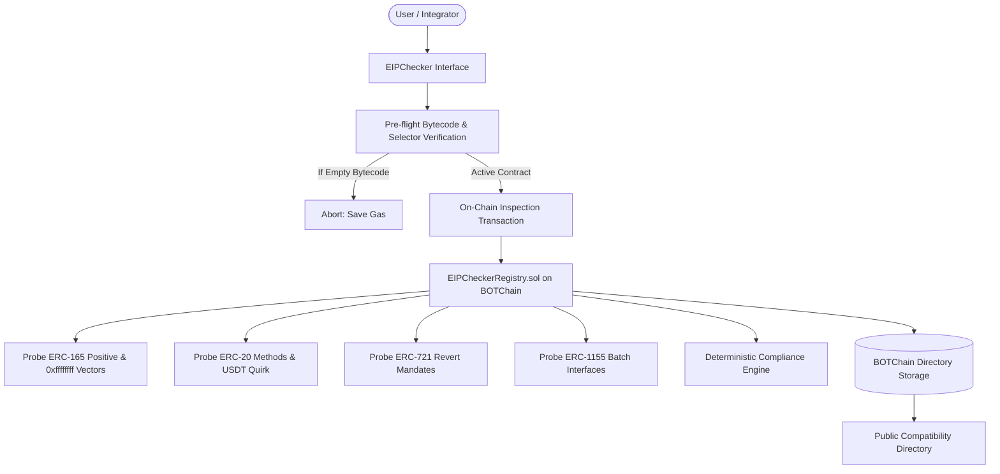

# EIPChecker Technical Whitepaper
**A Deterministic Runtime Standards Inspector & On-Chain Compatibility Directory for EVM Smart Contracts**

*Author: EIPChecker Core Engineering*  
*Network: BOTChain Testnet (Chain ID: 968)*  
*Contract Registry: `0x102888800e59ef5698dfc3d2768c489c9903c396`*  
*Date: November 2026*

---

## 1. Abstract
The Ethereum Improvement Proposal (EIP) ecosystem relies on formalized interface standards (ERC-20, ERC-721, ERC-1155, and ERC-165) to enable modular composability across decentralized protocols, automated market makers (AMMs), collateralized lending pools, and NFT marketplaces. However, in the existing EVM paradigm, **standard compliance is largely self-reported or inferred from static bytecode interfaces**.

A contract can broadcast compatibility with an Ethereum standard through docstrings, marketing, or superficial ERC-165 declarations without correctly fulfilling the specification's required state transitions, return payloads, or failure conditions. Such deviations have triggered catastrophic vulnerabilities across DeFi history—from silent transfer failures due to non-standard return values (e.g., the USDT void-return quirk) to marketplace exploits stemming from non-reverting ownership queries.

**EIPChecker** introduces a deterministic, multi-layered inspection architecture coupled with an on-chain verification registry (`EIPCheckerRegistry.sol`) on **BOTChain Testnet**. EIPChecker performs deep behavioral analysis, low-level calldata simulation, and edge-case boundary testing. Furthermore, all inspection and registry functions adhere strictly to a **Gas-Fee-Only** economic model: zero protocol, platform, or development taxation (`msg.value == 0`).

---

## 2. The Problem: The Illusion of Compliance

EVM interface inheritance (`is IERC20`, `is IERC721`) only validates selector presence at compile time. At runtime, four primary failure classes plague composability:

```
+-----------------------------------------------------------------------+
|                       EVM Compliance Failure Classes                  |
+-----------------------------------------------------------------------+
| 1. ERC-165 Self-Reporting Fallacy:                                    |
|    supportsInterface() returns true without executable implementation |
+-----------------------------------------------------------------------+
| 2. Spec-Violating Return Signatures:                                  |
|    transfer() returns void (0 bytes) instead of 32-byte boolean       |
+-----------------------------------------------------------------------+
| 3. Broken Revert Mandates:                                            |
|    ownerOf(invalidId) returns address(0) instead of throwing/reverting|
+-----------------------------------------------------------------------+
| 4. Malformed Interface Reflection:                                    |
|    supportsInterface(0xffffffff) throws or returns true               |
+-----------------------------------------------------------------------+
```

### 2.1 The ERC-165 Negative Vector Dilemma
Under official EIP-165 specifications, any compliant contract implementing `supportsInterface(bytes4 interfaceID)` must satisfy:
1. `supportsInterface(0x01ffc9a7) == true` (ERC-165 self-declaration).
2. `supportsInterface(0xffffffff) == false` (Explicit invalid interface rejection).

Many contracts naively return `true` for all queries, or throw an out-of-gas or unhandled revert on `0xffffffff`, misleading indexers, bridges, and cross-contract callers.

### 2.2 The "USDT Quirk" (Missing Boolean Return)
The formal EIP-20 specification states:
```solidity
function transfer(address to, uint256 value) external returns (bool);
```
Several major tokens deployed in early Ethereum history (notably USDT and early exchange tokens) omit the boolean return in their bytecode, returning `void` (0 bytes). Calling these contracts via standard Solidity `IERC20(target).transfer(...)` triggers an EVM `RETURNDATASIZE` check failure (`require(returnData.length >= 32)`), reverting transactions unexpectedly. Integrators are forced to use OpenZeppelin's `SafeERC20` wrapper, yet developers frequently forget, exposing protocols to frozen assets.

### 2.3 The Nonexistent Token Revert Mandate
EIP-721 explicitly states:
> *"NFTs assigned to zero address are considered invalid, and queries about them do throw."*

Non-compliant or hastily deployed ERC-721 implementations frequently return `address(0)` instead of reverting when querying `ownerOf(nonExistentId)`. This corrupts NFT indexers, fractionalization vaults, and marketplace balance tracking.

---

## 3. Architecture & Methodology

EIPChecker implements a dual-layer inspection pipeline:



### 3.1 On-Chain Probing Engine (`EIPCheckerRegistry.sol`)
Rather than relying solely on off-chain guesswork, `EIPCheckerRegistry.sol` executes atomic, gas-bounded low-level probes against the target contract via `staticcall` and `call`:

1. **ERC-165 Verification**:
   - `staticcall{gas: 25000}(0x01ffc9a7, 0x01ffc9a7)`
   - `staticcall{gas: 25000}(0x01ffc9a7, 0xffffffff)`
2. **ERC-721 Validation**:
   - Selector `0x80ac58cd` declaration.
   - Nonexistent token revert test: `staticcall{gas: 25000}(0x6352211e, uint256(999999999999999))`. If it returns success instead of reverting, `FLAG_REVERT_RULES_COMPLIANT` is denied.
3. **ERC-20 & Low-Level Return Inspection**:
   - Probes `totalSupply()` (`0x18160ddd`), `balanceOf(address)` (`0x70a08231`), `allowance(address, address)` (`0xdd62ed3e`).
   - Simulates `transfer(address(1), 0)` to capture raw return data size. If call succeeds with `returndatasize == 0`, `FLAG_NON_STANDARD_RETURN_TYPE` is activated.
4. **ERC-1155 Multi-Token Probing**:
   - Verifies identifier `0xd9b67a26` and batch query mechanisms.

### 3.2 Scoring Metric & Diagnostic Bitmask
Findings are stored on-chain using a compact 32-bit diagnostic bitmask:

| Flag Name | Value | Meaning |
| :--- | :--- | :--- |
| `FLAG_ERC165_SUPPORTED` | `1 << 0` (1) | Contract declares and responds to ERC-165 |
| `FLAG_ERC165_INVALID_VECTOR_SAFE` | `1 << 1` (2) | Correctly returns `false` on `0xffffffff` query |
| `FLAG_METADATA_SUPPORTED` | `1 << 2` (4) | Standard metadata getters (`name`, `symbol`, etc.) exist |
| `FLAG_STANDARD_SELECTORS_FOUND` | `1 << 3` (8) | Mandatory core interface methods confirmed |
| `FLAG_NON_STANDARD_RETURN_TYPE` | `1 << 4` (16) | Missing return boolean detected (USDT quirk) |
| `FLAG_REVERT_RULES_COMPLIANT` | `1 << 5` (32) | Strictly conforms to specification revert rules |
| `FLAG_CUSTOM_OR_SUSPICIOUS` | `1 << 6` (64) | Interface discrepancies or unusual selector behavior |

---

## 4. Economic Policy: Gas-Fee-Only

Decentralized developer utilities often inject rent-seeking tolls (`msg.value > 0`), protocol fees, or mandatory subscription tokens. EIPChecker adheres strictly to a **Gas-Fee-Only** ethos:

$$\text{Protocol Fee} = 0 \quad \forall \, f \in \text{EIPCheckerRegistry}$$

Users interact with the contract exclusively via standard network gas:
1. **Zero Protocol Fees**: The contract enforces `msg.value == 0`.
2. **Pre-flight Gas Protection**: Client checks bytecode existence prior to transaction dispatch. If the target address has 0 bytes (an EOA or un-deployed address), transaction execution is blocked client-side, eliminating wasted gas on guaranteed reverts.
3. **Public Commons**: Anyone can inspect, register, and query records without licensing fees or permissions.

---

## 5. Deployment on BOTChain Testnet

EIPChecker is deployed and verified on **BOTChain Testnet**:
- **Chain ID**: `968`
- **RPC Endpoint**: `https://rpc.bohr.life`
- **Native Currency**: `BOT`
- **Block Explorer**: `https://scan.bohr.life`
- **EIPCheckerRegistry Address**: [`0x102888800e59ef5698dfc3d2768c489c9903c396`](https://scan.bohr.life/address/0x102888800e59ef5698dfc3d2768c489c9903c396)
- **Deployment Transaction**: [`0xbbd11a31bb3c62a31ce8a03d96720c7de01b087c15493a5ed85d1e551bd7104f`](https://scan.bohr.life/tx/0xbbd11a31bb3c62a31ce8a03d96720c7de01b087c15493a5ed85d1e551bd7104f)

### Live Test Artifacts on BOTChain Testnet
- **Standard ERC-20 (`BSTT`)**: [`0x011b3f1df87355c5596f57751289fa3e23b0cc1b`](https://scan.bohr.life/address/0x011b3f1df87355c5596f57751289fa3e23b0cc1b)
- **USDT-Quirk Demo Token**: [`0x05c9a52b29e58ee799872d86150e61e6e0af4ae1`](https://scan.bohr.life/address/0x05c9a52b29e58ee799872d86150e61e6e0af4ae1)

---

## 6. Integrator & Developer Recommendations

1. **Never Rely Solely on ERC-165**: ERC-165 proves only what a contract *claims*, not how it executes. Always simulate critical pathways (`transfer`, `ownerOf`) or query the EIPChecker Registry.
2. **Mandate SafeERC20 for Token Transits**: If interacting with arbitrary ERC-20 tokens, enforce OpenZeppelin's `SafeERC20` to prevent unhandled revert failures caused by missing boolean returns.
3. **Verify Revert Paths in NFTs**: For NFT collateral vaults, confirm that `ownerOf` queries throw on invalid token IDs to prevent stale ownership states.

---

## 7. Conclusion
EIPChecker establishes a trust-minimized, deterministic foundation for Ethereum standard compliance on BOTChain Testnet. By combining low-level execution probing, transparent diagnostic bitmasks, and an immutable public directory under a gas-fee-only paradigm, EIPChecker elevates contract interoperability from superficial claims to verifiable behavior.
